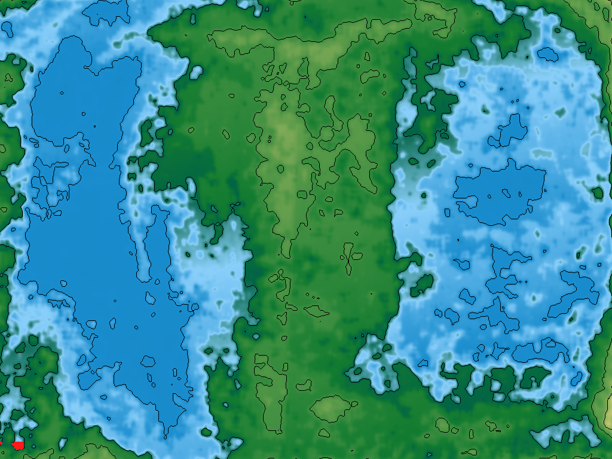
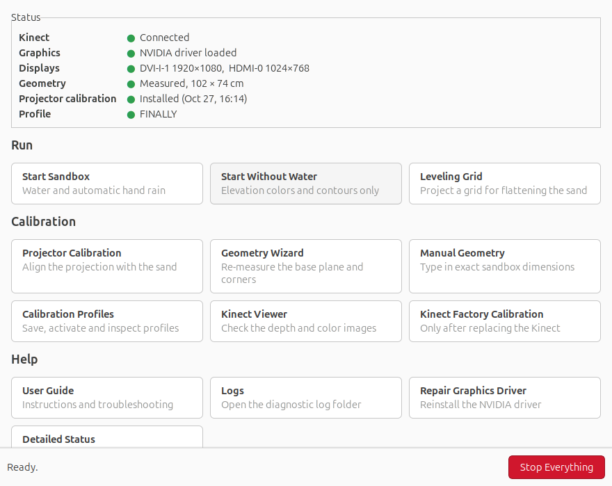
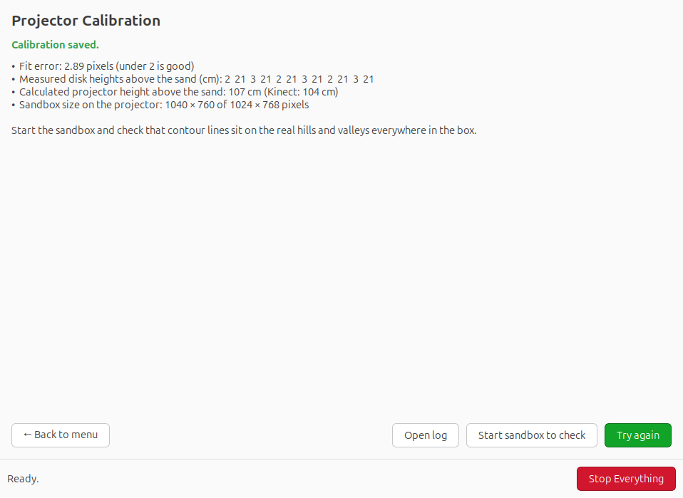

# AR Sandbox Kit

Install, calibrate and run an **Augmented Reality Sandbox** on Linux with a few commands and a point-and-click Control Center.



## What it is

An AR Sandbox is a box of sand with a depth camera and a projector above it. As you shape the sand, a live topographic map (colors, contour lines and flowing water) is projected back onto it. It is used in classrooms and museums to teach maps, watersheds and erosion.

The core software is [SARndbox](https://web.cs.ucdavis.edu/~okreylos/ResDev/SARndbox/) by Oliver Kreylos (UC Davis). It is powerful but command-line only, and its calibration is easy to get wrong. This kit adds:

- **One-step installer**: downloads, verifies, patches and builds Vrui, the Kinect package and SARndbox on a current Ubuntu.
- **Control Center**: live status of camera, graphics driver, displays and calibration, plus every tool behind one button.
- **Guided projector calibration**: shows the height of every captured point while you work, and rejects bad results with a plain explanation instead of installing them.
- **Desktop launchers**: Start, Stop, Control Center and Guide.
- **Helper tools**: leveling grid, geometry wizard, manual geometry entry, calibration profiles, and a one-click NVIDIA driver repair.
- **[User guide](docs/USER_GUIDE.md)** with a full troubleshooting section, and a [printable calibration target](docs/calibration-target-12cm.pdf).

| Control Center | Guided calibration |
|---|---|
|  |  |

## What you need

- **Kinect v1** for Xbox 360 (model 1414 or 1473) with its USB power adapter
- **Projector**, ideally short-throw at 1024×768, mounted beside the Kinect
- **PC** with Ubuntu 24.04 LTS and a dedicated GPU (tested: GTX 970 on driver 580), plus a separate monitor for the operator
- A box of sand, about 100 × 75 cm

## Quick start

```bash
git clone <this repository> ar-sandbox-kit
cd ar-sandbox-kit
./install.sh
```

The installer asks for your password and takes 20–60 minutes, most of it compiling. Then connect the Kinect and projector, log out and back in, open **AR Sandbox Control Center**, and follow *First-time setup* in the [user guide](docs/USER_GUIDE.md#first-time-setup-and-full-calibration).

Full instructions, including manual steps and other distributions: **[docs/INSTALL.md](docs/INSTALL.md)**.

## Repository layout

| Path | Contents |
|---|---|
| `install.sh` | Runs the three scripts below in order |
| `scripts/` | `install-dependencies.sh`, `build-sarndbox.sh`, `install-tools.sh`, `check-system.sh`, `uninstall-tools.sh` |
| `tools/` | Control Center and helper scripts (installed to `~/.local/share/ar-sandbox/bin`) |
| `patches/` | Two small source patches applied during the build |
| `config/` | Example settings file (projector output, resolution, paths) |
| `docs/` | User guide (Markdown and HTML), install guide, screenshots, calibration target |

## How it was made

Built September–November 2026 on a dedicated Ubuntu 24.04 PC (Kinect v1, BenQ projector, GTX 970). The upstream build was done with OpenAI Codex. The Control Center, calibration diagnostics and this kit were then written with Claude Code, after several failed projector calibrations showed what a beginner needs to see while calibrating.

## Credits

SARndbox, Vrui and the Kinect package are © Oliver Kreylos, UC Davis KeckCAVES, released under the GNU GPL v2. This kit does not include their source code: `build-sarndbox.sh` downloads the original releases and checks their SHA-256 sums.
