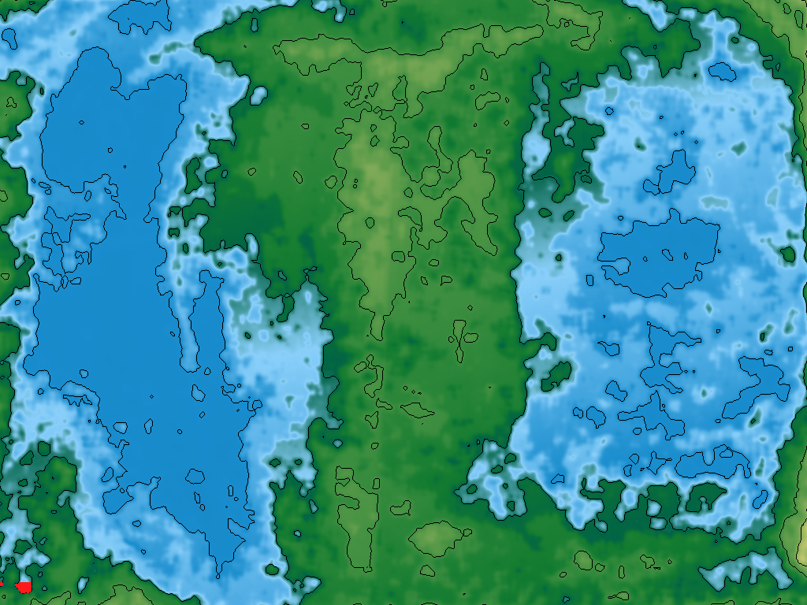
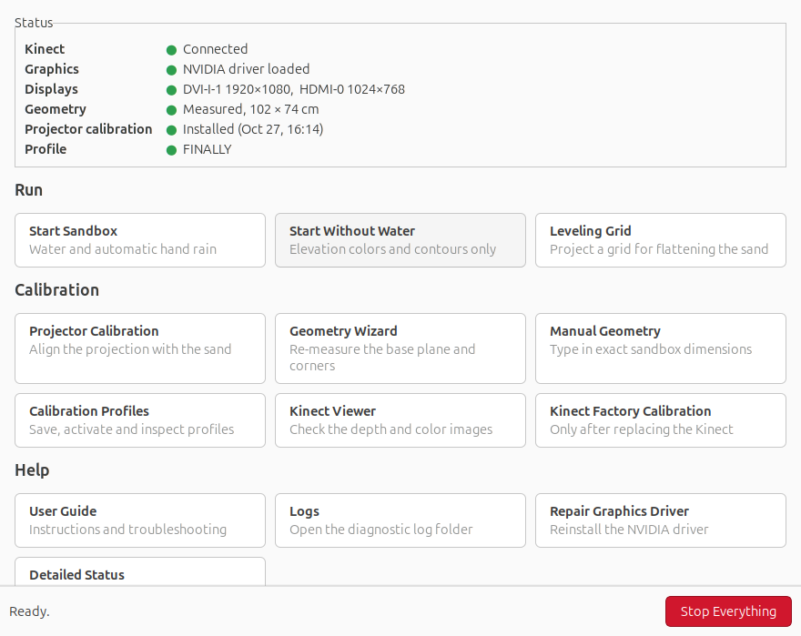
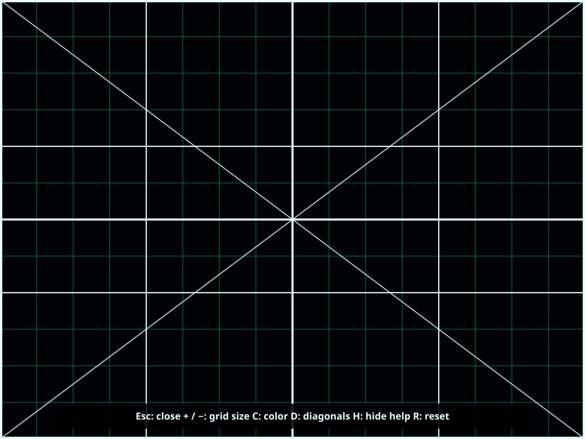
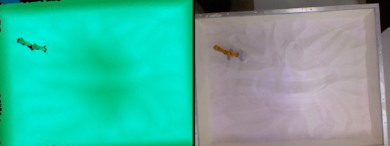
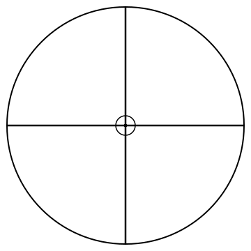
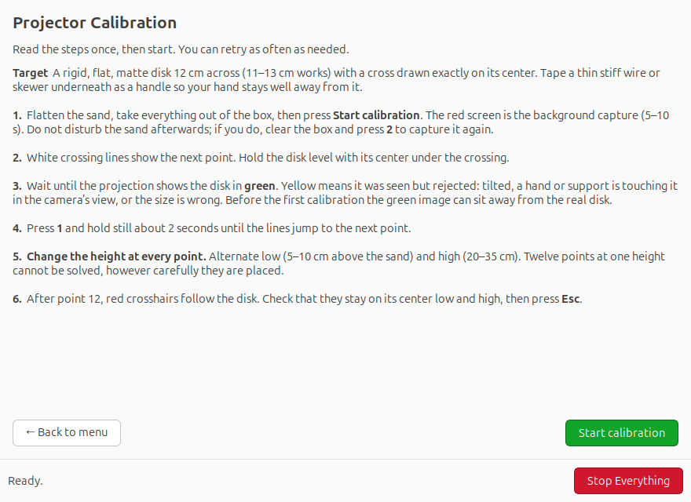
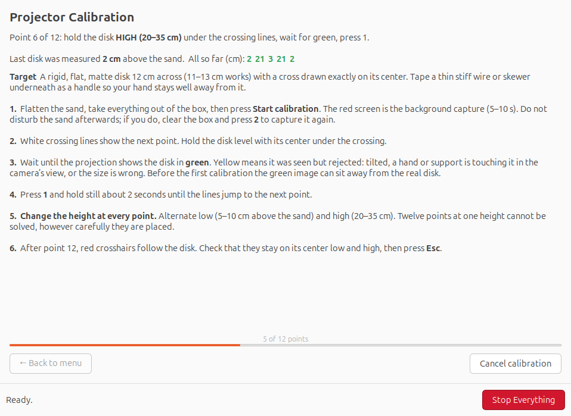
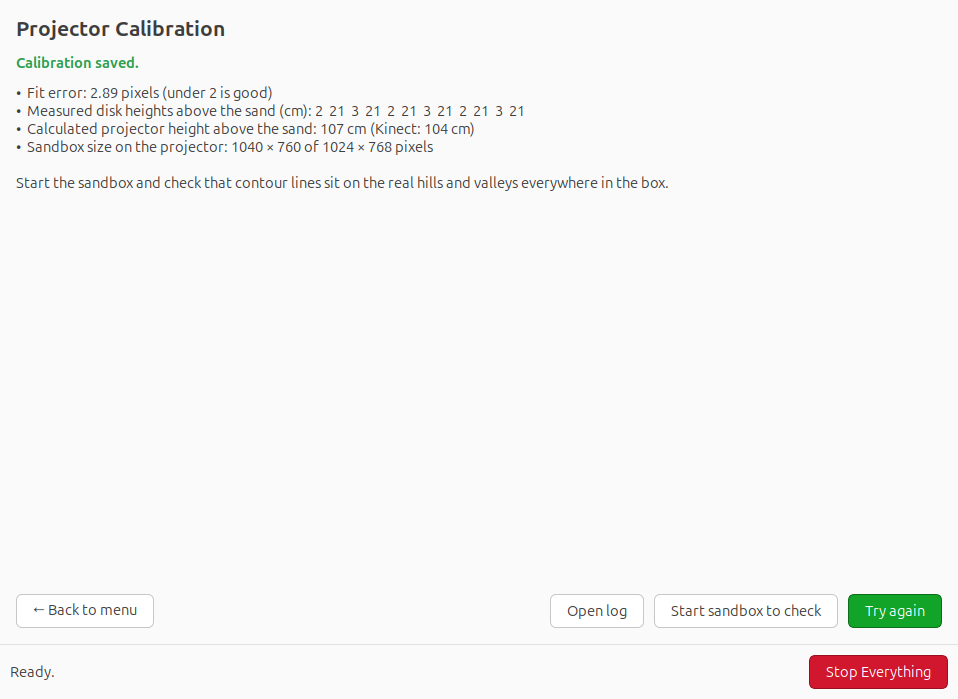
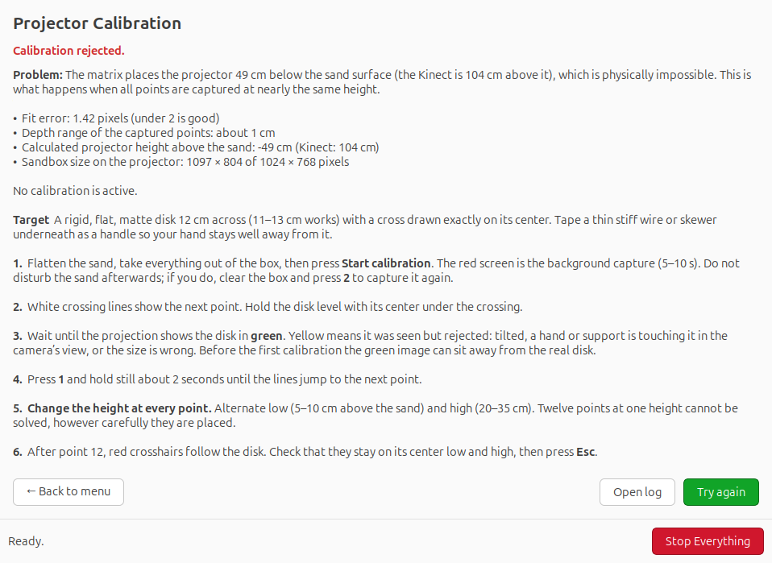

# AR Sandbox User Guide

How to run, calibrate, look after and troubleshoot the Augmented Reality Sandbox.

## Contents

1. [How it works](#how-it-works)
2. [Everyday use](#everyday-use)
3. [The Control Center](#the-control-center)
4. [Controls while the sandbox runs](#controls-while-the-sandbox-runs)
5. [Water and hand-triggered rain](#water-and-hand-triggered-rain)
6. [Leveling grid](#leveling-grid)
7. [First-time setup and full calibration](#first-time-setup-and-full-calibration)
8. [Projector calibration](#projector-calibration)
9. [Calibration profiles](#calibration-profiles)
10. [Repairing the graphics driver](#repairing-the-graphics-driver)
11. [Settings file](#settings-file)
12. [Troubleshooting](#troubleshooting)
13. [Files, logs and backups](#files-logs-and-backups)
14. [When to recalibrate](#when-to-recalibrate)

## How it works

A Kinect camera above the box measures the height of the sand 30 times a second. The computer turns those heights into a colored elevation map with contour lines and simulated water, and a projector next to the Kinect shines that map back onto the sand. Dig a hole and it fills with blue; build a mountain and it turns brown and white.

For the picture to land exactly on the sand, the computer needs three calibrations, each done once:

| Calibration | What it measures | Tool |
|---|---|---|
| Kinect factory calibration | The Kinect's own lens data, read from the device | Kinect Factory Calibration |
| Sandbox geometry | Where the flat sand surface and the four box corners are | Geometry Wizard or Manual Geometry |
| Projector calibration | How Kinect positions map to projector pixels | Projector Calibration |

## Everyday use

1. Switch on the projector, then the computer. The Kinect must have its power adapter plugged in.
2. Double-click **Start AR Sandbox** on the desktop. Water and hand rain are on.
3. To finish, press **Esc** on the sandbox, or double-click **Stop AR Sandbox**.

For anything else (calibrating, checking the camera, leveling the sand), open **AR Sandbox Control Center**.

> **One camera user at a time.** The sandbox, Kinect Viewer and Projector Calibration cannot use the Kinect simultaneously. Every Control Center action closes the others first.

## The Control Center

The window stays open while you work: every tool opens from it and you return to it when the tool closes. **Stop Everything** at the bottom closes the sandbox and all calibration programs. The line next to it shows what is open right now.

### Status panel

The panel refreshes every 3 seconds. Green is fine, amber needs attention soon, red stops the sandbox from working properly.

| Line | Green means | If it is not green |
|---|---|---|
| Kinect | The camera is on USB | Check its power adapter and USB cable |
| Graphics | The graphics card driver is working | See [Repairing the graphics driver](#repairing-the-graphics-driver) |
| Displays | Monitor and projector are separate displays | The monitor is off, mirrored, or the driver is not working |
| Geometry | Sand plane and corners are measured | Run the Geometry Wizard |
| Projector calibration | A valid calibration is installed, with its date | Run Projector Calibration |
| Profile | Name of the active calibration profile | Optional; see Calibration profiles |

### Buttons

| Button | What it does |
|---|---|
| **Start Sandbox** | Runs the sandbox with water and automatic hand rain |
| **Start Without Water** | Elevation colors and contours only; faster on weak graphics |
| **Leveling Grid** | Projects a grid to help flatten the sand |
| **Projector Calibration** | Aligns the projection with the sand (opens its own page) |
| **Geometry Wizard** | Re-measures the flat sand plane and the four corners |
| **Manual Geometry** | Type in the box's inside width and depth instead of clicking corners |
| **Calibration Profiles** | Save, switch and inspect calibration sets |
| **Kinect Viewer** | Shows the live depth and color images |
| **Kinect Factory Calibration** | Reads the lens data from the Kinect; only needed for a new Kinect |
| **User Guide** | Opens this guide |
| **Logs** | Opens the folder with all program logs |
| **Repair Graphics Driver** | Reinstalls the NVIDIA driver (NVIDIA cards only) |
| **Detailed Status** | Full text report: Kinect, displays, files, graphics, running programs |

## Controls while the sandbox runs

| Key or action | Effect |
|---|---|
| **1** | Rain over the whole sandbox |
| **2** | Drain water |
| Open hand above the sand | Local rain cloud under the hand |
| **Esc** | Close the sandbox |
| **F11** | Toggle full screen |
| Hold right mouse button | Vrui program menu |
| Move the mouse | Shows the cursor again after it hides |

## Water and hand-triggered rain

**Start AR Sandbox** and **Start Sandbox** include the water simulation and hand rain.

To make rain with your hand:

1. Hold one open hand, palm down, fingers slightly spread, 10–30 cm above the sand.
2. Keep it still for a moment until rain appears under it.
3. Move slowly to move the cloud. Take the hand away to stop.

Press **2** to drain the water. If the water runs slowly, use **Start Without Water**, or lower `WATER_GRID_WIDTH` / `WATER_GRID_HEIGHT` in the [settings file](#settings-file).

## Leveling grid

**Control Center → Leveling Grid** projects straight lines across the sand. Bumps and dips bend the lines, so smooth the sand until they look straight everywhere. Do this before the Geometry Wizard and before projector calibration.

| Key | Effect |
|---|---|
| **+** / **−** | Larger / smaller grid squares |
| **C** | Change color |
| **D** | Diagonal lines on/off |
| **H** | Help strip on/off (it hides by itself after 8 s) |
| **R** | Reset |
| **Esc** | Close |

The grid shows unevenness, not gravity-level. Use a spirit level on the box frame for that.

## First-time setup and full calibration

Do these in order after installing, after moving or replacing the Kinect or projector, or when alignment has gone wrong everywhere.

### 1. Mount the hardware

The Kinect must look straight down and see all four inside corners of the box; about 1 m above the sand works for a 100 × 75 cm box. Mount the projector next to it so its picture covers the box. Tighten both mounts: if either moves later, calibration has to be redone.

### 2. Check the system

Open the Control Center. Kinect, Graphics and Displays should be green. If not, see [Troubleshooting](#troubleshooting).

### 3. Kinect factory calibration

**Control Center → Kinect Factory Calibration.** Enter your password when asked. This reads the lens data stored inside the Kinect and only has to be done once per Kinect.

### 4. Look through the camera

**Control Center → Kinect Viewer.** The left picture is depth, the right is color. Check that the whole inside of the box is visible with few black holes, then close it with **Esc**.

### 5. Measure the sandbox geometry

Flatten the sand (use the Leveling Grid), take everything out of the box, then choose **Geometry Wizard**. It opens the Kinect Viewer and guides you:

**Step 1, the flat sand plane:**

1. Right-click the left (depth) image and enable **Average Frames**. Wait until it finishes.
2. Hold **P**, choose **Extract Planes**, release **P**.
3. Hold **P** and drag a large rectangle over flat sand only (no walls, no black holes); release.
4. Repeat once over another large flat area.

**Step 2, the four corners:**

1. Hold **M**, choose **Measure 3D Positions**, release **M**.
2. Tap **M** once at each inside corner, in this order: top-left, top-right, bottom-left, bottom-right. Stay the same small distance from the wall at each corner.

The wizard checks the measurements (opposite sides must match within 10 cm, corners must lie on the plane), backs up the old file and saves the new one. Because the geometry changed, the existing projector calibration is set aside: do projector calibration next.

> **Corners hard to see?** Do Step 1 of the wizard, then use **Manual Geometry**: measure the inside width and depth with a tape measure and type them in. It keeps the measured plane and orientation and makes an exact rectangle. Optional fields shift the rectangle right or forward, or rotate it, for small corrections. A backup is made first and the active profile is updated.

### 6. Projector calibration

See the next section.

### 7. Check the result

Start the sandbox. Build a hill and dig a hole. The contour lines should sit on the real slopes everywhere in the box, and the rain cloud should appear right under your hand.

## Projector calibration

This step teaches the computer how Kinect positions map to projector pixels. You hold a round target at 12 marked positions and the computer works out where the projector is.

### Make the target

1. Print **Calibration Target 12cm.pdf** (in the guide folder) at **100% / Actual size**. Check that the line on the page measures exactly 100 mm.
2. Cut out the circle and glue it flat onto an old CD or DVD (also 12 cm) or stiff card. The detector accepts 11–13 cm disks only.
3. Keep it matte: no lamination or glossy tape.
4. Prepare **two stands** narrower than the disk so they hide under it: one low (2–10 cm, for example a jar lid or mug) and one high (20–30 cm, for example a tall can or bottle). The heights must differ by at least 10 cm.

### Run it

1. Flatten the sand and take everything out of the box.
2. **Control Center → Projector Calibration → Start calibration.**
3. The projector shows a red screen for 5–10 s while it memorizes the empty sandbox. Stay out of the box.
4. White crossing lines appear. Put the **low** stand under them and lay the disk on it with the cross on the crossing lines.
5. Take your hands completely out of the box.
6. Wait until the projection shows the disk in **green**. Yellow means it was seen but rejected. Before the first calibration the green image can appear away from the real disk; that is normal.
7. Press **1** and keep still about 2 seconds until the lines jump to the next point.
8. Use the **high** stand for the next point, then low again, alternating for all 12 points.
9. After point 12, red crosshairs follow the disk. Check that they stay on its center at both heights, then press **Esc**.

While you work, the Control Center window on the monitor shows the height the Kinect measured for every captured point. They should alternate, for example `3 21 3 21 …`. If they all come out the same, the line turns red: change the stand before the next point.

### The result

When the calibrator closes, the Control Center checks the result and either installs it or explains what went wrong. Your previous calibration is put back if the new one fails, and **Try again** starts over.

| Check | Good value |
|---|---|
| Fit error | Under 2 pixels is very good; up to 5 is usable |
| Measured disk heights | At least 10 cm between the lowest and highest |
| Calculated projector height | Close to the real height of the projector above the sand |
| Sandbox size on the projector | Close to the projector resolution |

**Rejected** means the result is physically impossible, for example a projector "below the sand". This always comes from points captured at nearly the same height. **Unreliable** results (high fit error, small height range) are not installed automatically, but **Use this result anyway** installs them if you want to try.

## Calibration profiles

**Control Center → Calibration Profiles** stores the geometry and projector calibration together under a name, for example *Normal* and *Workshop table*.

| Action | Effect |
|---|---|
| View active profile | Shows the plane, the four corners, measured widths, depths and diagonals, and whether a projector calibration is included |
| Create profile from current | Saves the current files under a new name and makes it active |
| Activate profile | Makes a saved profile current; the current files are backed up first |
| Update active profile | Copies the current files into the active profile |
| Manual geometry adjustment | Same as the Control Center button |
| Open profiles folder | Shows the profile folders in the file manager |

Successful projector calibrations and manual geometry changes are copied into the active profile automatically.

## Repairing the graphics driver

The sandbox needs the graphics card's own driver. On Ubuntu, a kernel update can occasionally arrive without the matching NVIDIA module. After the next restart the computer then draws everything with the processor: **Graphics** turns red, the monitor and projector show the same small picture, and the sandbox becomes slow and cannot be calibrated.

To fix it, click **Repair driver** in the red bar (or **Help → Repair Graphics Driver**). A terminal window opens and:

1. Asks for your password.
2. Reinstalls the NVIDIA driver together with the newest kernel, so they match.
3. Adds the NVIDIA module to every other installed kernel.
4. Checks the result and offers to restart.

After the restart, Graphics should read **NVIDIA driver loaded**.

If the repair reports that no module is published yet for the newest kernel, hold **Shift** while the computer starts, choose **Advanced options for Ubuntu**, start the previous kernel, and run the repair again a day later.

## Settings file

`~/.config/ar-sandbox/ar-sandbox.conf` holds the settings for this computer. Edit it with any text editor and reopen the Control Center.

| Setting | Meaning | Default |
|---|---|---|
| `SANDBOX_ROOT` | Folder where SARndbox was built | `~/src/SARndbox-2.8` |
| `VRUI_PREFIX` | Where Vrui and the Kinect tools are installed | `/usr/local` |
| `PROJECTOR_OUTPUT` | Projector output name from `xrandr --query`, or `auto` | `auto` |
| `PROJECTOR_WIDTH`, `PROJECTOR_HEIGHT`, `PROJECTOR_RATE` | Projector mode | `1024`, `768`, `60` |
| `MONITOR_OUTPUT` | Operator monitor output, `auto`, or empty if none | `auto` |
| `WATER_GRID_WIDTH`, `WATER_GRID_HEIGHT` | Water simulation detail; smaller is faster | `200`, `150` |
| `NVIDIA_DRIVER` | NVIDIA driver series for the repair tool; empty for AMD/Intel | `580` |
| `DOCS_DIR` | Folder for this guide and the calibration profiles | `~/Documents/AR Sandbox` |

`auto` picks the only display, or the non-primary one when there are two. Set the names explicitly if the wrong screen is chosen. Changing the projector resolution requires a new projector calibration.

## Troubleshooting

### Starting and display

| Problem | Cause and fix |
|---|---|
| Graphics line is red; monitor and projector show the same picture | The graphics driver is not loaded. Use **Repair driver**, then restart |
| Sandbox opens on the monitor instead of the projector | Set `PROJECTOR_OUTPUT` and `MONITOR_OUTPUT` in the settings file (names from `xrandr --query`) |
| "The projector display could not be found" | Projector off, cable loose, or the configured output name changed. Check `xrandr --query` |
| Projector picture is blank | Projector power, input source and cable. Displays line should list the projector |
| Sandbox is slow or stutters | Check Graphics is green. Use Start Without Water, or reduce the water grid in the settings |
| Screen saver or blank screen during use | Move the mouse. Turn off screen blanking in Ubuntu Settings → Power |
| Wrong window position under Wayland | Choose **Ubuntu on Xorg** on the login screen (gear icon) |

### Kinect

| Problem | Cause and fix |
|---|---|
| Kinect line is red | The Kinect needs its own power adapter as well as USB. Try another USB port directly on the computer |
| "Interface 0 is already claimed" in a log | Another program is using the camera. Press **Stop Everything**, wait a few seconds, try again |
| Kinect Viewer: camera is in use | Same as above |
| Depth image has big black holes | Shiny or very dark objects, direct sunlight, or the Kinect is too close (under ~60 cm) |

### Geometry

| Problem | Cause and fix |
|---|---|
| "Could not extract plane" | Enable Average Frames first and wait. Draw a large rectangle on flat sand only, not walls or black areas |
| "Fewer than two valid plane measurements" | Two plane extractions are required before clicking the wizard's button |
| "Expected exactly four corner measurements" | Each **M** tap records one corner. Run the wizard again and tap exactly four times |
| Measurements failed consistency checks | Corners were clicked in the wrong order or on the wall. Order: top-left, top-right, bottom-left, bottom-right |
| Corners are impossible to see in the depth image | Use **Manual Geometry** with tape-measured dimensions |
| Projected outline is shifted or rotated | Manual Geometry's shift and rotate fields, then redo projector calibration |

### Projector calibration

| Problem | Cause and fix |
|---|---|
| Disk never turns green | It must sit on a stand, not on the sand. Disk 11–13 cm, flat, matte. Stand hidden under the disk. Hands out of the box |
| Disk flickers between green and yellow | Too close to the sand, or tilted. Use a taller low stand (5 cm or more) |
| Yellow blobs where nothing is | The sand changed since the red screen. Clear the box and press **2** to capture the background again |
| The disk looks white | Normal: the white crossing lines are shining on it |
| Lines do not move after pressing 1 | 1 was pressed before the disk was green. Make it green; the capture then finishes by itself |
| "Rejected … projector below the sand surface" | All points were at about the same height. Alternate the low and high stands |
| Measured heights are all the same although you used two stands | The Kinect is seeing something else (hand, stand edge). Check that the green circle moves when you move the disk |
| "Only N of 12 points were captured" | The calibrator was closed early. Nothing is saved until all 12 are done |
| "The sandbox would be drawn … far outside the image" | Points were badly off the crossing lines or the disk moved during capture. Try again |
| Fit error above 5 pixels | The cross on the disk was not under the crossing lines, or the disk moved. Hold still until the lines jump |
| Black screen with red lines when the sandbox starts | An invalid calibration is installed. The Control Center no longer installs these; recalibrate |
| Alignment good at sand level but off on high hills | Too little height difference between the stands. Recalibrate with 20–30 cm high points |

### Water and rain

| Problem | Cause and fix |
|---|---|
| No hand rain | Use Start Sandbox (water on). Open hand, fingers spread, 10–30 cm above the sand, keep still briefly |
| Rain appears next to the hand | Projector calibration is missing or poor |
| Water stays after closing | Press **2** before closing to drain |

### Graphics driver repair

| Problem | Cause and fix |
|---|---|
| "No NVIDIA module is published" | Start the previous kernel from the boot menu (hold Shift at start) and retry the next day |
| Password not accepted | The account needs administrator rights |
| Repair finished but Graphics still red | Restart once more. If still red, run `scripts/check-system.sh` from the project folder and keep its output |

## Files, logs and backups

| What | Where |
|---|---|
| Settings | `~/.config/ar-sandbox/ar-sandbox.conf` |
| Sandbox geometry | `<SANDBOX_ROOT>/etc/SARndbox-2.8/BoxLayout.txt` |
| Projector calibration | `<SANDBOX_ROOT>/etc/SARndbox-2.8/ProjectorMatrix.dat` |
| Kinect factory calibration | `<VRUI_PREFIX>/etc/Vrui-8.0/Kinect-3.10/IntrinsicParameters-<serial>.dat` |
| Calibration profiles | `~/Documents/AR Sandbox/Calibration Profiles` |
| Logs (every run, every calibration) | `~/.local/state/ar-sandbox` |
| Control Center and helper scripts | `~/.local/share/ar-sandbox/bin` |
| Vrui window and key settings | `~/.config/Vrui-8.0/Applications` |

Nothing is ever deleted. Old files are renamed with a time stamp:

| Suffix | Meaning |
|---|---|
| `.backup-<time>` | Replaced by a newer version |
| `.rejected-<time>` | A calibration that failed the checks |
| `.invalidated-<time>` | A projector calibration set aside because the geometry changed |

To restore one, rename it back to `BoxLayout.txt` or `ProjectorMatrix.dat`.

## When to recalibrate

| What changed | What to redo |
|---|---|
| Sand reshaped, normal use | Nothing |
| Kinect bumped or moved | Geometry, then projector calibration |
| Kinect replaced | Factory calibration, geometry, projector calibration |
| Projector moved, zoomed, or keystone changed | Projector calibration |
| Projector resolution changed | Set it in the settings file, then projector calibration |
| Box moved under fixed mounts | Geometry, then projector calibration |
| Graphics driver repaired | Nothing, unless the display layout changed |
